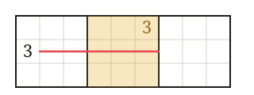

# Markdown 基础语法

本页展示正文里常用的 Markdown 写法及其显示效果，写作时可以对照着看。

## 标题

文章用一个一级标题 `#` 作为篇名，正文从二级标题 `##` 开始分节。二级标题会出现在左侧目录里当前文章的下方，
三级标题 `###` 只在正文中显示。

### 三级标题

三级标题适合在一节内部再分小段。

## 段落与强调

段落之间空一行。可以用 **粗体** 强调关键结论，用 *斜体* 表示术语，用 `行内代码` 写坐标或文本格式，
例如 `r4c5`、`r4c46(17)`。

> 引用块适合放补充说明或书中的原话。
>
> 可以有多段。

---

上面是一条分隔线。

## 列表

无序列表：

- 唯余法：某格只剩一个候选数
- 摒除法：某数在区域内只剩一个位置
  - 宫摒除
  - 行列摒除

有序列表：

1. 先找出所有提示数
2. 再逐个宫做摒除
3. 最后检查唯余

## 表格

| 技巧 | 难度 | 关键 |
| --- | :---: | --- |
| 唯余法 | ★ | 看一格的候选 |
| 宫摒除 | ★ | 看一个数在宫内的位置 |
| 唯一矩形 | ★★★ | 利用唯一解 |

## 代码块

普通代码块原样显示，不做高亮：

```text
....8.......5.2.....3...1...5.....2.8...9...66..375..9.15.2.83.....5.......739...
```

写成 `sudoku` 的代码块会变成盘面，见 [sudoku 盘面](sudoku-figure.md)。

## 图片

图片放在文章旁边，用相对路径引用，构建时会自动打包：



## 链接

站内文章之间的链接写相对路径，例如 [书籍与章节](books.md)；外链会在新标签页打开，例如
[数独文本格式规范](https://sudoku.kazusa.tech/appendix/sudoku-text-format)。详见 [链接](links.md)。
